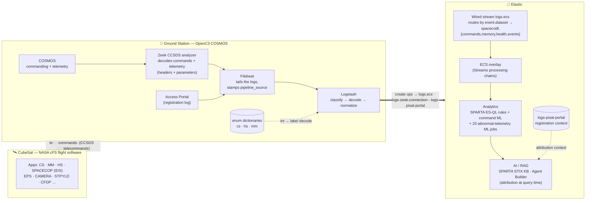
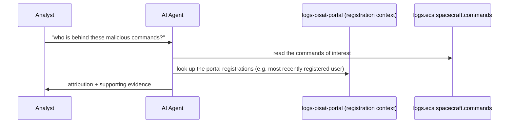

# DEFCON PiSat — data flow

End-to-end path from the satellite to the analytics, and what is collected at each hop.

## At a glance — who runs what

```
  ┌──────────────────┐   telemetry / logs   ┌───────────────────────────────┐        ┌──────────────────────────┐
  │     CubeSat      │ ───────────────────► │      GROUND STATION           │  ────► │         ELASTIC          │
  │  cFS flight SW   │                      │                               │        │                          │
  │                  │                      │  • UI / access portal         │        │  • Elasticsearch cluster │
  │  CS · MM · HS    │ ◄─────────────────── │  • Zeek  (decodes CCSDS)      │        │  • ECS normalization     │
  │  SPACECOP (IDS)  │      commands        │  • Filebeat  (collect + ship) │        │  • SPARTA rules + ML     │
  │  EPS · CAMERA …  │                      │  • Logstash  (normalize)      │        │  • AI / RAG (SPARTA KB)  │
  └──────────────────┘                      │       + enum dictionaries     │        └──────────────────────────┘
                                            └───────────────────────────────┘
        RF / CCSDS                              Filebeat → Logstash → Elastic            create ops into logs.ecs
```

The portal, Zeek, Filebeat, and Logstash run on the ground-station host; only the
Elasticsearch cluster is on the Elastic side. Logstash normalizes the feed before it ships.



---

## 1. Data sources collected

Each source is stamped with a `pipeline_source` so Logstash can route it and teardown can
remove it exactly.

| # | Source | What it carries | `pipeline_source` | Lands in |
|---|--------|-----------------|-------------------|----------|
| 1 | Zeek CCSDS **command** log (`ccsds_commands.log`) | operator commands on the wire — `target`, `command_name`, opcode, decoded parameters, `source.ip` | `zeek-ccsds` | `logs.ecs.spacecraft.commands` |
| 2 | Zeek CCSDS **telemetry** log (`ccsds_telemetry.log`) — CS/MM/HS | decommutated state: checksum/EEPROM/memory integrity, memory-manager action + address, CPU-hog state | `zeek-ccsds` | `logs.ecs.spacecraft.memory` · `.health` |
| 3 | Zeek CCSDS telemetry — **SPACECOP** | the on-board IDS alert message (`IDS_MSG`) | `zeek-ccsds` | `logs.ecs.spacecraft.events` |
| 4 | Zeek **`conn.log`** | network sessions (who talked to whom, ports, bytes) | `zeek-conn` | `logs-zeek.connection` |
| 5 | Access-**portal** registration log | `REGISTER` / `LOGIN` events — `email`, `ip`, timestamp | `pisat-portal` | `logs-pisat-portal` |

Both Zeek CCSDS logs ship under the single `zeek-ccsds` lane; Logstash splits command vs.
telemetry by content (a command carries `command_name`, telemetry carries `packet_name`).

---

## 2. Ground station — Filebeat

Filebeat tails each log file, ndjson-promotes the JSON, stamps the `pipeline_source`, and
ships to Logstash over the `beats` input (port 5044). It performs no transformation.

Config (`shipper/filebeat-pisat-inputs.yml`) — three `filestream` inputs:

```yaml
- type: filestream            # both Zeek CCSDS logs under one input
  paths:
    - /opt/zeek/logs/current/ccsds_commands.log
    - /opt/zeek/logs/current/ccsds_telemetry.log
  parsers: [ ndjson: { target: "", overwrite_keys: true } ]
  fields: { pipeline_source: zeek-ccsds }
  fields_under_root: true
# … + conn.log (zeek-conn, raw), portal log (pisat-portal)
```

---

## 3. Ground station — Logstash + dictionaries

Logstash is the normalization point:

- **Routing.** The wired-stream root is immutable and routes by `event.dataset`. A raw
  Zeek doc has none, so Logstash derives it: telemetry via `translate` on `packet_name`
  (`CS_HKPACKET`/`MM_HKPACKET` → `space.memory`, `HS_HKPACKET` → `space.health`,
  `SPACECOP_REPORT_TLM` → `space.events`); commands get `space.command`. Every OTHER packet
  (numeric gauge housekeeping — `EPS_HK_TLM`, `SYSMON_HK_TLM`, …) gets `space.telemetry`.
- **Nothing dropped.** Every telemetry packet also lands in `logs-pisat-telemetry` with its
  `parameters.*` typed as numbers (a ruby filter converts them), for the abnormal-telemetry ML.
- **Normalized layer.** The analytics read normalized fields, never raw vendor names.
  Logstash renames the Zeek fields (`src_ip` → `source.ip`, `command_name` →
  `command.name`, …) and decodes the integer telemetry states to labels via the dictionaries.
- **Portal overlay.** The portal registration log gets an ECS `authentication` overlay
  (`user.name`, `source.ip`, `service.name`, `event.category`, `event.action`).

**The dictionaries** (`shipper/dictionaries/*.json`) map raw integers to labels:

| Dictionary | Field | Grounded values |
|---|---|---|
| `cs_state.json` | Checksum integrity state | `0 EMPTY · 1 ENABLED · 2 DISABLED · 3 UNDEFINED` |
| `hs_state.json` | Health & Safety CPU-hog state | `0 DISABLED · 1 ENABLED` |
| `mm_lastaction.json` | Memory Manager last action | `2 POKE · 7 FILL · 10 EEPROMWRITE_ENA …` |
| `mm_memtype.json` | Memory type | `1 RAM · 2 EEPROM …` |

Every value is generated (`cluster/build_logstash.py`) from `cluster/decode_maps.py`,
traced to the flight-software source (`the-aerospace-corporation/spacecop-demo`).

Logstash routes: `conn.log` → the Zeek integration stream, the portal log →
`logs-pisat-portal`, all telemetry → `logs-pisat-telemetry`, and the decoded command +
state telemetry → the wired stream `logs.ecs` (create ops).

---

## 4. Elastic — ingest → ECS → analytics

**Ingest / routing.** Docs land in the wired stream `logs.ecs`; Streams routes each by
`event.dataset` into the existing core partitions (`logs.ecs.spacecraft.commands` /
`.memory` / `.health` / `.events`). No pisat-specific partitions.

**ECS overlay.** The partition processing chains add the ECS entity overlay
(`host.*`, `service.*`, `event.*`, `related.*`) on top of the normalized fields the shipper
produced, so the spacecraft indexes on the ECS alerts index and correlates across domains.

**Command analytics** (reading the normalized layer): the `defcon-*` SPARTA ES|QL rules
(hazardous command, command flooding, the SPACECOP IDS alert, integrity-disabled and CPU-hog
effects, the command-and-effect correlation) plus the population-rare command ML job.

**Abnormal-telemetry analytics:** 20 anomaly-detection ML jobs (`defcon-tlm-*`) on
`logs-pisat-telemetry`, one per security-relevant metric across the payloads (EPS power, SYSMON
host resources, HS/CFE_ES resets + CPU, CS memory/EEPROM integrity, CFE_SB/CI command-error
surges, STPYLD attitude/IMU + thermal, CAMERA/DS exfil, SPACECOP IDS health), each bound to a
`defcon-tlm-*-ml` rule — scoring an attack's EFFECT in the telemetry regardless of who commanded.

The SPARTA STIX knowledge base (Agent Builder / `spartastixkb`) supplies investigation-guide
detail, and performs command attribution at query time from `logs-pisat-portal`.

---

## 5. Attribution (who sent what)

Every attendee drives one shared COSMOS entity, and the portal registration log does not
map deterministically to any single command — so commands are **not** attributed at ingest.
Attribution is performed at **query time by the AI agent**, using the indexed portal
registration log as context.



Commands ship as plain wire docs with no `user.name`; the portal registration log is
captured and ECS-overlaid so the agent can reason over it.
